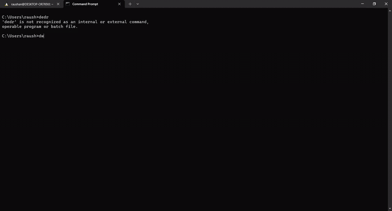

<div align="center">
  <h1>DWDR (Downloader)</h1>
  <p>A high-performance, self-contained terminal media downloader for Windows, macOS, and Linux.</p>

  [Installation] | [Commands] | [Examples] | [Configuration] | [Architecture] | [Changelog] | [Contributing]

  <br><br>

  
  <br>
  <sub><i>Interactive Shell Walkthrough &middot; <a href="assets/demo.mp4">MP4 Video</a></i></sub>
</div>

Source code repository for [DWDR]. It contains the CLI engine, interactive terminal shell, and configuration manager.

[DWDR]: https://github.com/raushan728/Downloader
[Installation]: INSTALL.md
[Commands]: docs/COMMANDS.md
[Examples]: docs/EXAMPLES.md
[Configuration]: docs/CONFIGURATION.md
[Architecture]: docs/ARCHITECTURE.md
[Changelog]: CHANGELOG.md
[Contributing]: CONTRIBUTING.md

## Why DWDR?

- **Performance:** Direct progressive stream downloading with multi-tier exact filesize resolution, real-time responsive visual progress bar featuring sub-character blocks (`▏▎▍▌▋▊▉█`), TrueColor cyan-to-green gradients, EMA speed smoothing with 20-sample sparkline history (`▁▂▃▅▇`), Braille spinners, boxed summary cards, and strict MP4 audio/video merging.

- **Reliability:** Zero system pollution. Isolated engines ([yt-dlp], [FFmpeg]) reside exclusively in `~/.dwdr/deps/` without modifying system package directories. Process group isolation and signal handling terminate intermediate child processes cleanly on cancellation without orphans. Single-video safeguards (`--no-playlist`) prevent accidental multi-track playlist dumps, self-healing configuration handles corrupted settings automatically, active download locks prevent race conditions, duplicate detection protects existing files, anti-bot verification and platform authentication support browser cookies (Brave, Chrome, Edge, Firefox, Opera, Vivaldi, Chromium, Safari, auto, or `cookies.txt`) with Smart Fallback (probing anonymously first and authenticating only when challenged), and automated cleanup purges incomplete `.part` files on cancellation.

- **Productivity:** Pure terminal ergonomics featuring an interactive non-blocking REPL shell ([inquire]), concurrent background download queue with parallel capacity controls (`max_parallel_downloads`), in-place real-time monitoring (`status` and `queue live`), clean format selection, native desktop folder selection dialogs ([rfd]) with headless fallback, and smart quality fallback.

- **Portability:** Built on pure Rust TLS ([rustls]) via [reqwest], enabling zero-effort compilation across Linux, macOS, and Windows without OpenSSL dependencies. Features native ARM64 and x86_64 binary architecture detection, proxy environment routing, and exponential backoff retry.

[yt-dlp]: https://github.com/yt-dlp/yt-dlp
[FFmpeg]: https://ffmpeg.org/
[inquire]: https://github.com/mikaelmello/inquire
[rfd]: https://github.com/PolyMeilex/rfd
[rustls]: https://github.com/rustls/rustls
[reqwest]: https://github.com/seanmonstar/reqwest

## Quick Start

Download any media stream directly:

```bash
dwdr "https://www.youtube.com/watch?v=VIDEO_ID"
```

Or open the interactive shell to inspect formats and configure settings:

```bash
dwdr
```

For practical walkthroughs and real-world scenarios, see the [Usage Examples][Examples].

## Installing from Source

If you want to build and install from source, see [INSTALL.md][Installation].

## Documentation

Comprehensive topic guides covering every subsystem:

| Guide | Scope | Description |
| :--- | :--- | :--- |
| [CLI Reference Guide][cli-guide] | Syntax & Flags | CLI arguments, options, direct downloads, and exit codes. |
| [Command Catalog][Commands] | Command Matrix | Complete reference table of all CLI options, subcommands, and REPL actions. |
| [Usage Examples][Examples] | Practical Walkthroughs | Step-by-step scenarios: single downloads, audio extraction, GUI folder pickers, and troubleshooting. |
| [Configuration Guide][Configuration] | Settings & Schema | `config.toml` structure, default resolutions, parallel thread limits, and self-healing recovery. |
| [Architecture Deep Dive][Architecture] | Core Mechanics | Process streaming, dependency lifecycle, single-video safeguards, and cross-platform compilation architecture. |
| [Architecture Decisions (ADR)][ADR] | Decision Log | Historical context, rejected alternatives, and trade-offs for architectural choices. |

[cli-guide]: docs/CLI.md
[ADR]: docs/adr/README.md

## Getting Help

Feel free to contact me by email at `raushansinghrajpoot687@gmail.com`, on [`LinkedIn`](https://www.linkedin.com/in/raushan-singh-807916390/) or on [`Twitter`](https://twitter.com/Raushan_090).

## Contributing

See [CONTRIBUTING.md][Contributing].

Please open an issue first to discuss proposed features or architectural modifications before submitting a pull request.

## License

DWDR is distributed under the terms of the MIT license. See [LICENSE](LICENSE) for details.